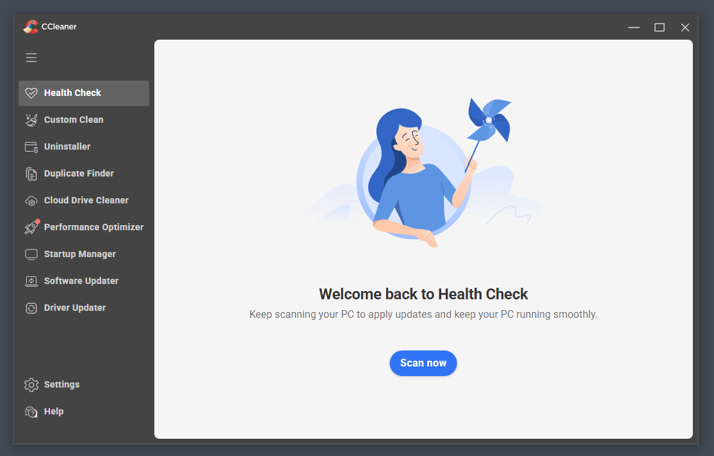

# CCleaner Classic Features Patcher

**UI / UX restoration only for CCleaner 7**

  

Restores a few classic behaviours that many long-time users  
(including paid licence holders) requested after the CCleaner 7 redesign.

- **X** button fully exits the program (instead of leaving it running)
- **Minimize** button sends the window to the system tray
- Optional classic **grey theme** (light & dark) replacing the new colours

### Download CCleaner 7 Setup

- [Official builds page](https://www.ccleaner.com/ccleaner/builds)
- [Direct download (Free / Full installer)](https://bits.avcdn.net/productfamily_CCLEANER7/insttype_FREE/platform_WIN/installertype_FULL/build_RELEASE/)

---

## What this is **not**

- **NOT** a license crack, keygen, bypass or activation tool
- Does **NOT** remove, disable or interfere with licensing / activation
- Does **NOT** unlock Pro features for free users
- Does **NOT** modify online checks, servers or authentication logic

The patches change only window-close / minimize behaviour  
and a few colour values in the UI CSS.  
All code is fully open and can be inspected by anyone.

---

## Features

### Patching

- Classic window behaviour restored as described above
- Automatically finds every copy of `CCleaner.exe`  
  (Program Files, Desktop or any folder layout) and patches all of them
- Drag & drop support (drop `CCleaner.exe` onto the window or the `.cmd`)
- Smart detection – inspects the actual file so a restored original  
  is always re-patched and an already-patched file is never patched twice
- Dry-run mode to preview changes without touching anything

### Optional Grey Theme

- Recolours the UI (light & dark) by editing only the theme CSS
- Main executable remains untouched for the theme part
- Fully reversible with one-click undo

### Safety & Convenience

- Automatic backups (`CCleaner.exe.bak` + `.orig` theme files)
- Restore / undo options for both patch and theme
- Auto-closes a running CCleaner (and any error window) before patching
- Requests administrator rights only at the moment of patching
- Completely portable – ships with its own Python runtime  
  (nothing needs to be installed on the system)

---

## Technical notes

- Pattern-based binary patching of `CCleaner.exe` (no fixed offsets)
- Simple CSS colour replacement for the theme
- Backups are created before any modification
- Authenticode signature is removed (unavoidable when the binary is changed)
- Pure Python 3 (standard library only) + small launcher script

---

## Who it is for

Created at the request of CCleaner users (including people with valid  
paid licences) who preferred the classic close/minimize behaviour  
and the older grey look of CCleaner 6.

---

## Disclaimer

CCleaner is a trademark of Gen Digital / Piriform.  
This is an unofficial community project and is not affiliated with,  
endorsed by, or supported by the developers of CCleaner.
